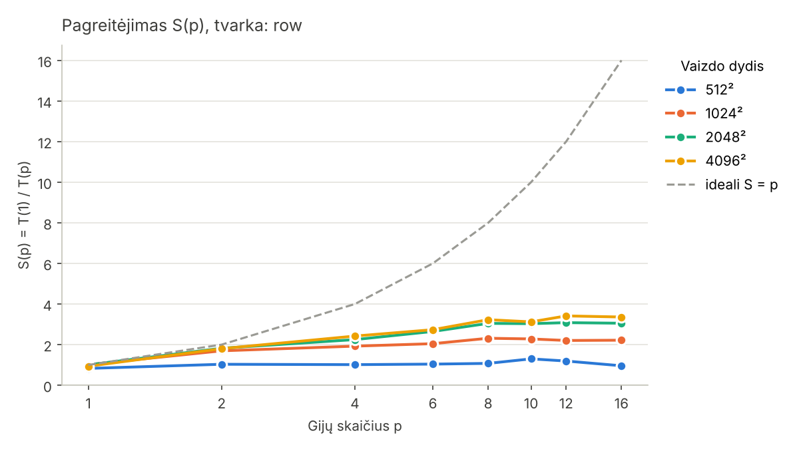
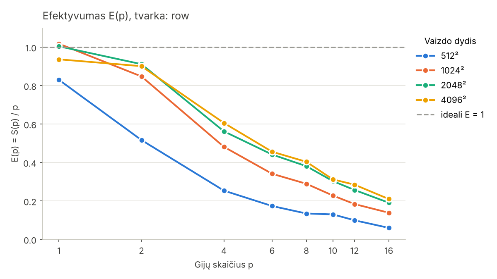
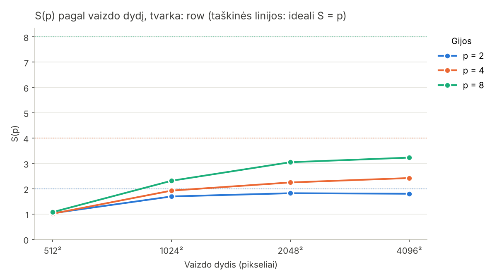

# Edge-detection-program

Kraštų aptikimo programa, naudojanti **Sobel** operatorių. Projekte realizuotos dvi versijos:

- **nuosekli** (`sobelSequential`) – visas vaizdas apdorojamas vienoje gijoje;
- **lygiagreti** (`sobelParallel`) – vaizdo eilutės padalijamos į intervalus ir kiekvieną intervalą apdoroja atskira `std::thread` gija.

Abi versijos naudoja tą pačią funkciją `sobelRows`, todėl jų rezultatai turi būti identiški – programa tai patikrina automatiškai.

## Reikalavimai

- C++17 palaikantis kompiliatorius (MSVC, GCC arba Clang)
- [CMake](https://cmake.org/) 3.10 ar naujesnė versija
- Papildomų bibliotekų nereikia – vaizdų skaitymui ir rašymui naudojamos į projektą įtrauktos `stb_image.h` ir `stb_image_write.h`

## Kompiliavimas

Projekto šakniniame kataloge:

```bash
cmake -S . -B build -DCMAKE_BUILD_TYPE=Release
cmake --build build --config Release
```

Sukuriamos dvi programos:

| Programa    | Paskirtis                                                      |
|-------------|----------------------------------------------------------------|
| `edge`      | Vieno vaizdo kraštų aptikimas ir nuoseklios/lygiagrečios versijos palyginimas |
| `benchmark` | Našumo matavimai su skirtingais vaizdo dydžiais ir gijų skaičiais |

Vykdomieji failai atsiranda `build/` kataloge (naudojant Visual Studio generatorių – `build/Release/`).

> Rekomenduojama visada kompiliuoti `Release` režimu – `Debug` režimo laikai nėra reprezentatyvūs.

## Naudojimas

### `edge` – kraštų aptikimas

```bash
edge [--input <failas>] [--size <N>] [--threads <P>]
```

| Parametras  | Numatytoji reikšmė            | Aprašymas |
|-------------|-------------------------------|-----------|
| `--input`   | *(nėra)*                      | Įvesties vaizdas (PNG, JPEG, PGM ir kiti `stb_image` palaikomi formatai). Spalvotas vaizdas automatiškai paverčiamas pilkumo atspalviais. Jei nenurodyta – sugeneruojamas testinis vaizdas. |
| `--size`    | `1024`                        | Generuojamo testinio vaizdo dydis (`N × N`). Naudojamas tik tada, kai nenurodytas `--input`. Turi būti bent 3. |
| `--threads` | procesoriaus gijų skaičius    | Lygiagrečios versijos gijų skaičius. Turi būti bent 1. |

Visi parametrai neprivalomi ir gali būti nurodyti bet kokia tvarka.

**Pavyzdžiai** (paleidžiama iš projekto šakninio katalogo):

```bash
# Sugeneruoti 1024x1024 testinį vaizdą ir naudoti visas procesoriaus gijas
./build/edge

# Sugeneruoti 4096x4096 testinį vaizdą ir naudoti 8 gijas
./build/edge --size 4096 --threads 8

# Apdoroti savo nuotrauką su 4 gijomis
./build/edge --input nuotraukos/katinas.jpg --threads 4
```

Windows (Visual Studio generatorius):

```powershell
.\build\Release\edge.exe --input nuotraukos\katinas.jpg --threads 4
```

**Išvesties pavyzdys** (laikai priklauso nuo kompiuterio):

```
Vaizdas: 1024x1024, gijos = 8
Nuosekli:    7.412 ms
Lygiagreti:  1.538 ms
Pagreitejimas: 4.819x
Rezultatai SUTAMPA
```

**Rezultato failas** išsaugomas `img/` kataloge (sukuriamas automatiškai dabartiniame darbo kataloge):

- su `--input katinas.jpg` → `img/katinas_edges.png`
- be `--input`, su `--size 4096` → `img/test_4096_edges.png`, o sugeneruotas testinis vaizdas išsaugomas kaip `img/test_4096.png`

**Grąžinami kodai:**

| Kodas | Reikšmė |
|-------|---------|
| `0`   | Viskas gerai, nuoseklios ir lygiagrečios versijų rezultatai sutampa |
| `1`   | Rezultatai **nesutampa** (klaida lygiagrečioje versijoje) |
| `2`   | Klaida (neteisingas parametras, nepavyko nuskaityti/įrašyti failo ir pan.) |

### `benchmark` – našumo matavimai

```bash
./build/benchmark
```

Programa parametrų nepriima. Ji:

1. sugeneruoja testinius vaizdus, kurių dydžiai **512, 1024, 2048 ir 4096** pikselių;
2. kiekvienam dydžiui išmatuoja nuoseklią versiją ir lygiagrečią versiją su **1, 2, 4, 6, 8, 10, 12, 16** gijų (bei procesoriaus gijų skaičiumi, jei jo sąraše nėra);
3. kiekvienam matavimui atlieka 1 apšilimo paleidimą ir 5 matavimus, naudojama jų **mediana**;
4. patikrina, ar lygiagretus rezultatas sutampa su nuosekliu;
5. rezultatus išveda į ekraną ir įrašo į `results/benchmark.csv`.

CSV faile stulpelių skyriklis yra `;`, o dešimtainis ženklas – kablelis (pvz. `1,1782`), todėl failą galima tiesiogiai atidaryti Excel su lietuviškais nustatymais.

CSV failo stulpeliai:

| Stulpelis    | Aprašymas |
|--------------|-----------|
| `size`       | Vaizdo kraštinės ilgis pikseliais |
| `threads`    | Gijų skaičius `p` |
| `seq_ms`     | Nuoseklios versijos laikas (ms) |
| `par_ms`     | Lygiagrečios versijos laikas (ms) |
| `speedup`    | Pagreitėjimas `S = seq_ms / par_ms` |
| `efficiency` | Efektyvumas `E = S / p` |

> **Dėmesio:** `benchmark` perrašo esamą `results/benchmark.csv` failą. Jei norite išsaugoti ankstesnius rezultatus, prieš paleisdami juos nukopijuokite.

## Rezultatai

Išmatuoti rezultatai pateikti `results/benchmark.csv`, o grafikai – `results/plots/`:

| Pagreitėjimas | Efektyvumas | Pagreitėjimas pagal dydį |
|---------------|-------------|--------------------------|
|  |  |  |

## Projekto struktūra

```
├── CMakeLists.txt
├── src/
│   ├── main.cpp                  # programa „edge“
│   ├── benchmark.cpp             # programa „benchmark“
│   ├── convolution.h/.cpp        # Sobel operatorius ir nuosekli versija
│   ├── convolution_parallel.cpp  # lygiagreti versija (std::thread)
│   ├── image.h/.cpp              # vaizdo struktūra, skaitymas, rašymas, testinio vaizdo generavimas
│   └── stb_image*.h              # vaizdų skaitymo/rašymo bibliotekos
├── results/                      # benchmark rezultatai ir grafikai
└── img/                          # programos „edge“ rezultatai (kuriamas automatiškai, neįtraukiamas į git)
```
